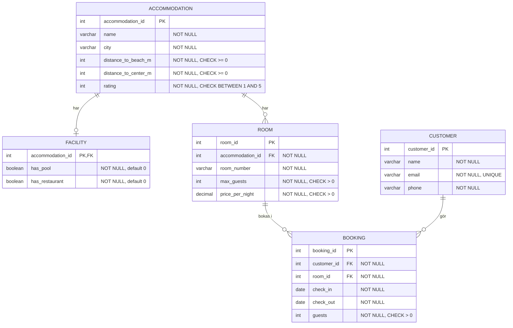

# Holiday Maker – E/R-diagram

## Diagram



## Tabeller, nycklar och begränsningar

### ACCOMMODATION (boende)
| Kolumn | Typ | Regler |
|---|---|---|
| accommodation_id | INT | **Primärnyckel**, auto-increment |
| name | VARCHAR(100) | NOT NULL |
| city | VARCHAR(100) | NOT NULL |
| distance_to_beach_m | INT | NOT NULL, CHECK >= 0 |
| distance_to_center_m | INT | NOT NULL, CHECK >= 0 |
| rating | INT | NOT NULL, CHECK BETWEEN 1 AND 5 |

### FACILITY (faciliteter)
| Kolumn | Typ | Regler |
|---|---|---|
| accommodation_id | INT | **Primärnyckel och främmande nyckel** → ACCOMMODATION(accommodation_id) |
| has_pool | BOOLEAN | NOT NULL, default 0, CHECK IN (0, 1) |
| has_restaurant | BOOLEAN | NOT NULL, default 0, CHECK IN (0, 1) |

Primärnyckeln innebär att det kan finnas högst en facilitetsrad per boende.
Främmande nyckeln innebär att varje facilitetsrad måste tillhöra ett befintligt
boende. Databasen kräver däremot inte att ett boende har en facilitetsrad:
skapa därför en sådan för varje boende, helst i samma transaktion. En saknad
rad betyder okända faciliteter, inte att faciliteterna saknas.

### ROOM (rum)
| Kolumn | Typ | Regler |
|---|---|---|
| room_id | INT | **Primärnyckel**, auto-increment |
| accommodation_id | INT | **Främmande nyckel** → ACCOMMODATION(accommodation_id), NOT NULL |
| room_number | VARCHAR(20) | NOT NULL |
| max_guests | INT | NOT NULL, CHECK > 0 |
| price_per_night | DECIMAL(10,2) | NOT NULL, CHECK > 0 |

Extra: `UNIQUE (accommodation_id, room_number)`. Rumsnummer är unika inom ett boende, men samma nummer får finnas på olika boenden.

### CUSTOMER (kund)
| Kolumn | Typ | Regler |
|---|---|---|
| customer_id | INT | **Primärnyckel**, auto-increment |
| name | VARCHAR(100) | NOT NULL |
| email | VARCHAR(150) | NOT NULL, **UNIQUE** |
| phone | VARCHAR(30) | NOT NULL |

### BOOKING (bokning)
| Kolumn | Typ | Regler |
|---|---|---|
| booking_id | INT | **Primärnyckel**, auto-increment (= bokningsnummer) |
| customer_id | INT | **Främmande nyckel** → CUSTOMER(customer_id), NOT NULL |
| room_id | INT | **Främmande nyckel** → ROOM(room_id), NOT NULL |
| check_in | DATE | NOT NULL |
| check_out | DATE | NOT NULL |
| guests | INT | NOT NULL, CHECK > 0 |

Extra constraints:
- `CHECK (check_out > check_in)`
- `CHECK (check_in >= '2026-12-01' AND check_out <= '2027-01-01')`. Alla rum kan bokas under december 2026, och utcheckning den 1 januari är ok.

## Relationer
| Relation | Kardinalitet | Implementeras med |
|---|---|---|
| Boende – Faciliteter | 1 till 0 eller 1 | `FACILITY.accommodation_id` PK och FK |
| Boende – Rum | 1 till många | `ROOM.accommodation_id` FK |
| Kund – Bokning | 1 till många | `BOOKING.customer_id` FK |
| Rum – Bokning | 1 till många | `BOOKING.room_id` FK |

Varje bokning gäller exakt en kund och ett rum. En kund kan ha flera bokningar. Ett rum kan ha många bokningar, men inte överlappande.

## Normalisering och designval
- Boendets uppgifter lagras en gång i ACCOMMODATION och inte per rum (3NF).
- Pool och restaurang lagras i en separat FACILITY-rad kopplad till boendet.
- Kunduppgifter lagras en gång i CUSTOMER och inte per bokning.
- **Antal nätter och totalpris lagras inte.** I MySQL beräknas de med `DATEDIFF(check_out, check_in) * price_per_night`. Det undviker dubbellagring.
- Priset ligger på rummet och är detsamma under hela perioden (enligt förenklingen). Om rummets pris ändras påverkas dock även totalpriset för tidigare bokningar. För att bevara priset vid bokning kan man i stället spara nattpriset på bokningen.
- `guests <= max_guests` kan inte uttryckas som CHECK över flera tabeller. Kontrollera det i SQL/applikationen vid bokning och ändring.
- Valfritt: en separat CITY-tabell kan motiveras i reflektionen, men det behövs inte här.
- ON DELETE: undvik CASCADE från kund/rum till bokning (använd `NO ACTION`/`RESTRICT`), så att historik inte raderas av misstag. Avbokning är ett explicit `DELETE` på BOOKING.

## Tillgänglighetsvillkor
Ett rum är **upptaget** om det finns en bokning som uppfyller:

```sql
b.check_in < @checkOut AND b.check_out > @checkIn
```

- Utcheckning samma dag som ny incheckning räknas som ledigt (strikta `<` och `>`).
- Fångar även att en period omsluter en annan.

```sql
SELECT a.name, a.city, r.room_number, r.max_guests, r.price_per_night
FROM room r
JOIN accommodation a ON a.accommodation_id = r.accommodation_id
LEFT JOIN facility f ON f.accommodation_id = a.accommodation_id
WHERE a.city = @city
  AND r.max_guests >= @guests
  AND (@requirePool = 0 OR f.has_pool = 1)
  AND (@requireRestaurant = 0 OR f.has_restaurant = 1)
  AND NOT EXISTS (
      SELECT 1 FROM booking b
      WHERE b.room_id = r.room_id
        AND b.check_in < @checkOut
        AND b.check_out > @checkIn)
ORDER BY r.price_per_night ASC;
```

Ange `@requirePool` och `@requireRestaurant` som 1 när respektive filter är
aktivt, annars 0. `LEFT JOIN` visar även boenden utan facilitetsrad när filtren
är avstängda; en saknad rad uppfyller inte ett aktivt facilitetsfilter.
Maxavstånd läggs till som parametriserade villkor, och sorteringen är
`r.price_per_night ASC` eller `a.rating DESC`.
