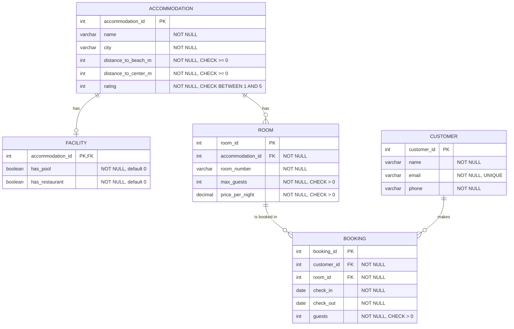

# Holiday Maker – ER diagram

## Diagram



## Tables, keys and constraints

### ACCOMMODATION
| Column | Type | Rules |
|---|---|---|
| accommodation_id | INT | **Primary key**, auto-increment |
| name | VARCHAR(100) | NOT NULL |
| city | VARCHAR(100) | NOT NULL |
| distance_to_beach_m | INT | NOT NULL, CHECK >= 0 |
| distance_to_center_m | INT | NOT NULL, CHECK >= 0 |
| rating | INT | NOT NULL, CHECK BETWEEN 1 AND 5 |

### FACILITY
| Column | Type | Rules |
|---|---|---|
| accommodation_id | INT | **Primary key and foreign key** → ACCOMMODATION(accommodation_id) |
| has_pool | BOOLEAN | NOT NULL, default 0, CHECK IN (0, 1) |
| has_restaurant | BOOLEAN | NOT NULL, default 0, CHECK IN (0, 1) |

The primary key allows at most one facility row per accommodation. The
foreign key requires each facility row to belong to an existing accommodation.
The database does not require every accommodation to have a facility row, so
create one for each accommodation, preferably in the same transaction. A
missing row means the facilities are unknown, not that they are absent.

### ROOM
| Column | Type | Rules |
|---|---|---|
| room_id | INT | **Primary key**, auto-increment |
| accommodation_id | INT | **Foreign key** → ACCOMMODATION(accommodation_id), NOT NULL |
| room_number | VARCHAR(20) | NOT NULL |
| max_guests | INT | NOT NULL, CHECK > 0 |
| price_per_night | DECIMAL(10,2) | NOT NULL, CHECK > 0 |

Additional constraint: `UNIQUE (accommodation_id, room_number)`. Room numbers
are unique within an accommodation but may be reused at different accommodations.

### CUSTOMER
| Column | Type | Rules |
|---|---|---|
| customer_id | INT | **Primary key**, auto-increment |
| name | VARCHAR(100) | NOT NULL |
| email | VARCHAR(150) | NOT NULL, **UNIQUE** |
| phone | VARCHAR(30) | NOT NULL |

### BOOKING
| Column | Type | Rules |
|---|---|---|
| booking_id | INT | **Primary key**, auto-increment (= booking number) |
| customer_id | INT | **Foreign key** → CUSTOMER(customer_id), NOT NULL |
| room_id | INT | **Foreign key** → ROOM(room_id), NOT NULL |
| check_in | DATE | NOT NULL |
| check_out | DATE | NOT NULL |
| guests | INT | NOT NULL, CHECK > 0 |

Extra constraints:
- `CHECK (check_out > check_in)`
- `CHECK (check_in >= '2026-12-01' AND check_out <= '2027-01-01')`. Rooms can be booked during December 2026, with checkout on 1 January allowed.

## Relationships
| Relationship | Cardinality | Implemented with |
|---|---|---|
| Accommodation – Facility | 1 to 0 or 1 | `FACILITY.accommodation_id` PK and FK |
| Accommodation – Room | 1 to many | `ROOM.accommodation_id` FK |
| Customer – Booking | 1 to many | `BOOKING.customer_id` FK |
| Room – Booking | 1 to many | `BOOKING.room_id` FK |

Each booking is for exactly one customer and one room. A customer can have
multiple bookings. A room can have multiple bookings, but they must not overlap.

## Normalization and design choices
- Accommodation details are stored once in ACCOMMODATION rather than per room (3NF).
- Pool and restaurant availability are stored in a separate FACILITY row linked to the accommodation.
- Customer details are stored once in CUSTOMER rather than per booking.
- **The number of nights and total price are not stored.** In MySQL the total is calculated with `DATEDIFF(check_out, check_in) * price_per_night`, avoiding duplicate stored values.
- The price belongs to the room and remains the same throughout the stay, as specified by the assignment. Changing the room price also changes the displayed total for existing bookings. To preserve the price at booking time, the nightly price could instead be stored on the booking.
- `guests <= max_guests` cannot be expressed as a CHECK across tables. The application checks it when creating or changing a booking.
- A separate CITY table could be discussed in the reflection, but is not needed here.
- Foreign keys use `RESTRICT` rather than cascading customer or room deletion to bookings, preventing accidental loss of booking history. Cancellation explicitly deletes the BOOKING row.

## Availability condition
A room is **occupied** if an existing booking satisfies:

```sql
b.check_in < @checkOut AND b.check_out > @checkIn
```

- Checkout on the day of a new check-in is allowed because the comparisons use strict `<` and `>`.
- The condition also detects one period completely containing another.

```sql
SELECT a.name, a.city, r.room_number, r.max_guests, r.price_per_night
FROM room r
JOIN accommodation a ON a.accommodation_id = r.accommodation_id
LEFT JOIN facility f ON f.accommodation_id = a.accommodation_id
WHERE a.city = @city
  AND r.max_guests >= @guests
  AND (@requirePool = 0 OR f.has_pool = 1)
  AND (@requireRestaurant = 0 OR f.has_restaurant = 1)
  AND NOT EXISTS (
      SELECT 1 FROM booking b
      WHERE b.room_id = r.room_id
        AND b.check_in < @checkOut
        AND b.check_out > @checkIn)
ORDER BY r.price_per_night ASC;
```

Set `@requirePool` and `@requireRestaurant` to 1 when the corresponding filter
is active, otherwise 0. The `LEFT JOIN` also includes accommodations without a
facility row when the filters are off; a missing row does not satisfy an active
facility filter. Maximum distances are added as parameterized conditions, and
the sort order is `r.price_per_night ASC` or `a.rating DESC`.
